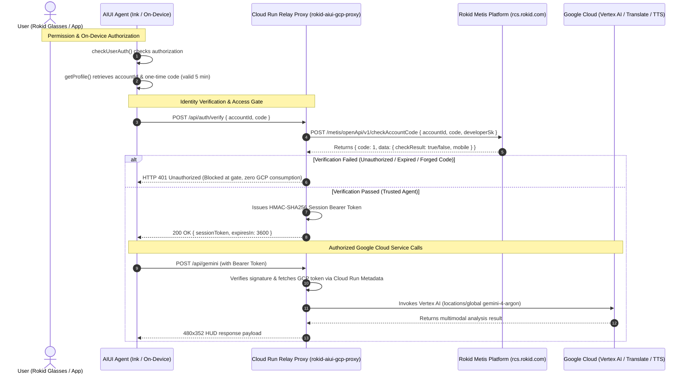

# Rokid Glasses AIUI Demos Collection

[English](README.en.md) | [中文](README.md)

[](https://aiui.rokid.com/)
[](https://github.com/yodaos-project/AIUI)
[-4285F4?style=flat-square&logo=google-cloud)](https://cloud.google.com/vertex-ai)
[-25D366?style=flat-square)](#-monochrome-green-scientific-interface-design-system)

This repository is a monorepo of Rokid AR Smart Glasses applications built on the official **Rokid AIUI 0.18** specification (`@yodaos-pkg/aix-cli@0.10.1`) and **Google Cloud Vertex AI**. Both agents follow the **Monochrome-Green Scientific Interface** design system with an all-English UI tailored for the **480 × 352** monochrome-green MicroLED waveguide viewport—delivering pure black-as-transparent optics, high contrast, and low-glare multimodal AI interaction.

---

## 📂 Repository Structure

```text
rokid-aiui-demos/
├── .agent/skills/
│   ├── aiui-dev/                          # AIUI 0.18 component, API & WXSS visual specification skill
│   └── rokid-aiui-lifecycle/              # End-to-end build, ADB deploy, AV recording & Studio submission skill
├── demos/
│   ├── 01-rokid-vision-voice-copilot/     # Demo 1: Vision Voice Copilot (Voice Q&A + Cloud Vision + IMU Dashboard)
│   │   ├── app.json                       # AIUI >=0.18.0 manifest (least-privilege: CAMERA, RECORD_AUDIO)
│   │   ├── app.js
│   │   ├── pages/index/index.ink          # English monochrome-green HUD (CHAT / VISION / DASHBOARD)
│   │   ├── assets/icon.png                # 512x512 custom icon
│   │   ├── assets/review/                 # On-device video (demo.mp4), preview.gif, cover.png & shot1..3.png
│   │   └── package.json
│   │
│   └── 02-rokid-gcp-multimodal-agent/     # Demo 2: GCP Multimodal Agent (Gemini 4 Vision + Live Subtitles + Cloud Telemetry)
│       ├── app.json                       # AIUI >=0.18.0 manifest (least-privilege: CAMERA only)
│       ├── app.js
│       ├── gcp_config.js                  # Cloud Run authenticated relay client config (zero client keys)
│       ├── server/
│       │   └── gcp_relay_server.mjs       # Cloud Run / local relay gateway (Vertex AI Global gemini-4-argon)
│       ├── pages/index/index.ink          # English three-mode monochrome-green HUD (GEMINI / TRANSLATE / CLOUD)
│       ├── assets/icon.png                # 512x512 custom icon
│       ├── assets/review/                 # On-device video (demo.mp4), preview.gif, cover.png & shot1..3.png
│       └── package.json
│
├── scripts/                               # On-device AV capture, video verification & AIUI Studio upload scripts
├── docs/                                  # Engineering guide & Studio review submission kit
│   ├── REVIEW_SUBMISSION.md               # Rokid AIUI Studio review & submission kit (with live review status)
│   └── ROKID_AIUI_DEVELOPMENT_TESTING_DEPLOYMENT_GUIDE.md
│
├── package.json                           # Monorepo scripts (preview, pack, relay & proxy E2E tests)
├── AGENTS.md                              # Agent manifest & hardware capability definitions
├── README.en.md                           # English documentation
└── README.md
```

> 📖 **Engineering & Review Documentation**:
> - [Rokid AIUI End-to-End Lifecycle Skill (`rokid-aiui-lifecycle`)](.agent/skills/rokid-aiui-lifecycle/SKILL.md): Covers AIUI 0.18 spec compliance, ADB on-device deployment, synchronized AV screen/audio recording, Vertex AI Global `gemini-4-argon` integration, and AIUI Studio submission.
> - [Rokid AIUI Studio Review & Submission Kit (`REVIEW_SUBMISSION.md`)](docs/REVIEW_SUBMISSION.md): Exact submission metadata, permission purpose strings, network/data disclosures, and current Studio review status for both agents.
> - [Rokid AIUI Development, Testing, Packaging & Deployment Guide](docs/ROKID_AIUI_DEVELOPMENT_TESTING_DEPLOYMENT_GUIDE.md): Dual-platform deployment, `cache.zip` regex validation rules, and Cloud Run authentication relay architecture.

---

## 🎯 Demo Projects Overview

### 🌟 Demo 1: Vision Voice Copilot (`01-rokid-vision-voice-copilot`)

An integrated hardware-software English HUD Copilot built on Rokid Glasses native sensors and the AIUI 0.18 specification (declared permissions: `["CAMERA", "RECORD_AUDIO"]`).


🎬 **On-Device Review Video (with Audio)**: [demos/01-rokid-vision-voice-copilot/assets/review/demo.mp4](demos/01-rokid-vision-voice-copilot/assets/review/demo.mp4)

#### Core Capabilities:
1. **Hands-Free Voice Interaction (`CHAT` Mode)**:
   - A single temple tap (`Enter` / `GlobalHook`) triggers `SpeechRecognition` voice transcription;
   - Streams concise English answers from the host `LanguageModel` (Rokid Metis LLM);
   - Plays low-latency TTS output (guarded by a character-length timeout fallback) with tap-to-interrupt support.
2. **Multimodal Scene Capture (`VISION` Mode via Cloud Run Proxy)**:
   - Center crosshair reticle frames the target; a temple tap calls `CameraContext.takePhoto({ quality: 'low' })` to capture an `image/webp` frame;
   - **Why Vision Uses the Cloud Run Proxy**: Because the built-in Rokid `LanguageModel` (Metis) silently drops `image_url` inputs, `VISION` mode sends the Base64 frame through the authenticated Google Cloud Run relay proxy to **Vertex AI Gemini 4 (`gemini-4-argon`, `locations/global`)** for live scene understanding and TTS readback.
3. **Attitude & Telemetry Awareness (`DASHBOARD` Mode)**:
   - Reads the built-in `Gyroscope` sensor in real time to display head pitch, roll, and runtime telemetry.

| Mode 1: `CHAT` Standby HUD | Mode 2: `CHAT` Voice Q&A | Mode 3: `VISION` Live Scene Recognition |
| :---: | :---: | :---: |
|  |  |  |

---

### 🚀 Demo 2: GCP Multimodal Agent (`02-rokid-gcp-multimodal-agent`)

Integrates **Google Cloud** AI services (**Vertex AI Gemini 4 `gemini-4-argon` on `locations/global`**, Cloud Translation v2, and Cloud Text-to-Speech v1) into an all-English Rokid Glasses HUD (following least-privilege rules with `["CAMERA"]` as its only declared permission).


🎬 **On-Device Review Video (with Audio)**: [demos/02-rokid-gcp-multimodal-agent/assets/review/demo.mp4](demos/02-rokid-gcp-multimodal-agent/assets/review/demo.mp4)

#### Core Capabilities:
1. **Vertex AI Gemini 4 (`gemini-4-argon`) Spatial Multimodal Reasoning (`GEMINI` Mode)**:
   - Captures a photo from the front camera and sends it through the authenticated Cloud Run proxy to Vertex AI `locations/global` (`gemini-4-argon`) for live scene analysis and spoken feedback.
2. **AR Live Bilingual Subtitles (`TRANSLATE` Mode)**:
   - Powered by Google Cloud Translation API v2, rendering bilingual subtitles in the upper HUD safe zone with TTS playback.
3. **GCP Node Telemetry & Auth Console (`CLOUD` Mode)**:
   - Monitors the Cloud Run relay `/health` endpoint, Vertex AI `gemini-4-argon` node connectivity, and round-trip latency (RTT).

| Mode 1: `GEMINI` Vision Reasoning | Mode 2: `TRANSLATE` Live Subtitles | Mode 3: `CLOUD` Node Health Console |
| :---: | :---: | :---: |
|  |  |  |

---

## 🔐 Google Cloud Authentication Architecture & Rokid Runtime Guide

Per the official Rokid specification ([Account Authorization & Verification](https://rokid.yuque.com/ub8h5n/bkz4ul/0f9c5f6b12acbf80ce81e0eafd0220b8?singleDoc#)), accessing Google Cloud from Rokid Glasses (running on a lightweight QuickJS runtime) requires agent identity verification and cloud resource protection without shipping client-side secrets.

This project deploys a production **Google Cloud Run Authenticated Relay Service (`rokid-aiui-gcp-proxy`)** enforcing a strict **Rokid Metis Agent Identity Gate**:



### 1. Cloud Run Production Endpoint
- **Cloud Run Service**: `rokid-aiui-gcp-proxy`
- **Production URL**: `https://rokid-aiui-gcp-proxy-766918001064.us-central1.run.app`
- **GCP Project**: `cellular-cider-495602-r9` (Cloud Run Region: `us-central1`; Vertex AI Location: `global` / Model: `gemini-4-argon`)
- **Health Check**: `GET https://rokid-aiui-gcp-proxy-766918001064.us-central1.run.app/health`

### 2. Authentication & Security Gate Rules
1. **Unauthenticated Requests Blocked**: Requests missing a valid Bearer Session Token or verification code immediately return `401 Unauthorized`.
2. **One-Time Code Verification**: The `code` issued by Rokid Metis expires in 5 minutes and is invalidated after a single verification to prevent replay attacks.
3. **Secret Isolation**: `ROKID_DEVELOPER_SK` is stored exclusively in Cloud Run server environment variables; zero secrets or API keys exist in the client package.
4. **Keyless Cloud Run Auth**: The Cloud Run container acquires Google Cloud access tokens automatically via the GCP Instance Metadata service (ADC).

### 3. End-to-End Proxy Verification Suite
Run `PROXY_URL=https://rokid-aiui-gcp-proxy-766918001064.us-central1.run.app node demos/02-rokid-gcp-multimodal-agent/scripts/test_proxy_auth_e2e.mjs`:
| Test Case | Expected Behavior | Status | Measured Latency |
| :--- | :--- | :---: | :---: |
| `GET /health` | Returns service health, project info & auth protocol | ✅ PASS | 678 ms |
| `POST /api/gemini` (No credentials) | Security gate blocks request with HTTP 401 | ✅ PASS | 403 ms |
| `POST /api/translate` (No credentials) | Security gate blocks request with HTTP 401 | ✅ PASS | 243 ms |
| `POST /api/auth/verify` (Invalid code) | Rejects invalid code with HTTP 401 | ✅ PASS | 206 ms |
| `POST /api/auth/verify` (Valid agent) | Verifies agent & issues Bearer Session Token | ✅ PASS | 245 ms |
| `POST /api/translate` (Valid token) | Invokes Cloud Translation v2 & returns translation | ✅ PASS | 1423 ms |
| `POST /api/gemini` (Valid token) | Invokes Vertex AI Gemini 4 (`gemini-4-argon`) | ✅ PASS | 4350 ms |
| `POST /api/tts` (Valid token) | Invokes Cloud Text-to-Speech & synthesizes audio | ✅ PASS | 781 ms |
| `POST /api/translate` (X-Rokid headers) | Single-shot header verification & translation call | ✅ PASS | 373 ms |

---

## 🎨 Monochrome-Green Scientific Interface Design System

To match the Rokid monochrome-green MicroLED optical waveguide display, the HUD strictly follows these rules:
- **Micro-Display Viewport**: `480 × 352` px, full-bleed with zero outer border overflow;
- **Pure Black is Transparent**: Background is strictly `#000000`, which renders as completely transparent on the optical waveguide without obstructing the physical world;
- **Scientific Green Luminance Hierarchy**:
  - `100% Luminance (#40ff5e)`: Primary indicators, focused text, and active controls;
  - `72% Luminance (rgba(64, 255, 94, 0.72))`: Secondary copy, timestamps, and sensor readouts;
  - `48% Luminance (rgba(64, 255, 94, 0.48))`: `1px` card borders and structural dividers;
  - `24% Luminance (rgba(64, 255, 94, 0.24))`: Inactive tabs and reticle ticks;
  - `12% Luminance (rgba(64, 255, 94, 0.12))`: Highlighted pill backgrounds;
  - `4%–6% Luminance`: Subtle card surface fills.

---

## 🛠️ Quick Start & Operations

### 1. Install Dependencies
```bash
git clone git@github.com:goriri/rokid-aiui-demos.git
cd rokid-aiui-demos
npm install
```

### 2. Local Preview & Relay

Start Demo 1 hot-reload simulator preview:
```bash
npm run preview:demo1
```

Start Demo 2 hot-reload simulator preview:
```bash
npm run preview:demo2
```

Start the local GCP relay server:
```bash
npm run gcp:relay
```

### 3. Build Production Packages (`.aix`)

Build AIUI `>=0.18.0` production archives with `@yodaos-pkg/aix-cli@0.10.1`:
```bash
# Build Demo 1 (demos/01-rokid-vision-voice-copilot/dist/rokid-glasses-copilot.aix)
npm run pack:demo1

# Build Demo 2 (demos/02-rokid-gcp-multimodal-agent/dist/rokid-gcp-multimodal-agent.aix)
npm run pack:demo2
```

### 4. ADB On-Device Deployment (`aix-cli 0.10.1`)

With Rokid Glasses connected over USB, deploy and launch directly from each demo directory using `npx aix`:
```bash
# Switch the glasses AIUI runtime to developer mode
npx aix device -s <device_serial> set-dev

# Install the packaged .aix archive and launch the entry page
npx aix install -s <device_serial> dist/<name>.aix
npx aix launch-page -s <device_serial> dist/<name>.aix pages/index/index
```

### 5. Temple Touchpad & Keyboard Mapping
| Temple Gesture | Keyboard Key | Action |
| :--- | :--- | :--- |
| **Single Tap** | `Enter` / `Space` | Capture photo / Start voice turn / Next subtitle / Interrupt TTS |
| **Swipe Forward / Back** | `↓` (`ArrowDown`) / `↑` (`ArrowUp`) | Cycle through the three HUD modes |
| **Back / Exit** | `Backspace` / `Escape` | Never calls `preventDefault()`, allowing native AIUI 0.18 exit/back navigation |

---

## 📄 License
Released under the MIT License.
