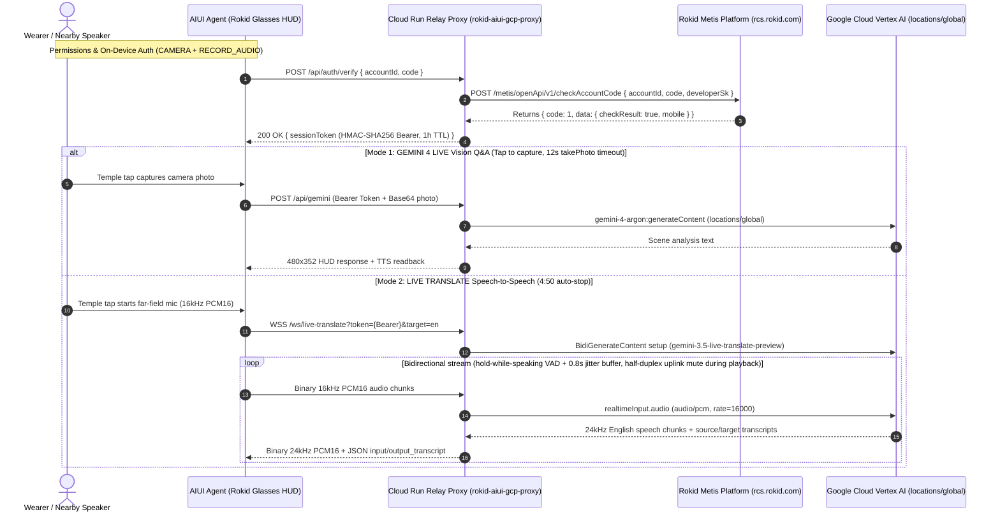

# Rokid Glasses AIUI Demos Collection

[English](README.en.md) | [中文](README.md)

[](https://aiui.rokid.com/)
[](https://github.com/yodaos-project/AIUI)
[](https://cloud.google.com/vertex-ai)
[](#-monochrome-green-scientific-interface-design-system)

This repository is a monorepo of Rokid AR Smart Glasses applications built on the official **Rokid AIUI 0.18** specification (`@yodaos-pkg/aix-cli@0.10.1`) and **Google Cloud Vertex AI**. Both agents follow the **Monochrome-Green Scientific Interface** design system with an all-English UI tailored for the **480 × 352** monochrome-green MicroLED waveguide viewport—delivering pure black-as-transparent optics, high contrast, real-time speech-to-speech translation, and low-glare multimodal AI interaction.

---

## 📂 Repository Structure

```text
rokid-aiui-demos/
├── .agent/skills/
│   ├── aiui-dev/                          # AIUI 0.18 component, API & WXSS visual specification skill
│   └── rokid-aiui-lifecycle/              # End-to-end build, ADB deploy, AV recording & Studio submission skill
├── demos/
│   ├── 01-rokid-vision-voice-copilot/     # Demo 1: Vision Voice Copilot (Voice Q&A + Cloud Vision + IMU Dashboard)
│   │   ├── app.json                       # AIUI >=0.18.0 manifest (permissions: CAMERA, RECORD_AUDIO)
│   │   ├── app.js
│   │   ├── pages/index/index.ink          # English monochrome-green HUD (CHAT / VISION / DASHBOARD)
│   │   ├── assets/icon.png                # 512x512 custom icon
│   │   ├── assets/review/                 # On-device video (demo.mp4), preview.gif, cover.png & shot1..3.png
│   │   └── package.json
│   │
│   └── 02-rokid-gcp-multimodal-agent/     # Demo 2: GCP Live Translator v1.0.12 (Gemini Live Speech Translation + Gemini 4 Vision + Cloud Console)
│       ├── app.json                       # AIUI >=0.18.0 manifest (permissions: CAMERA, RECORD_AUDIO)
│       ├── app.js
│       ├── gcp_config.js                  # Cloud Run HTTP + WebSocket authenticated relay client config (zero client keys)
│       ├── server/
│       │   └── gcp_relay_server.mjs       # Cloud Run gateway (Vertex AI Global gemini-4-argon + gemini-3.5-live-translate-preview)
│       ├── scripts/                       # Host E2E & cloud test scripts (test_gemini_image.mjs, test_live_translate.mjs, test_proxy_auth_e2e.mjs)
│       ├── pages/index/index.ink          # English three-mode monochrome-green HUD (GEMINI 4 LIVE / LIVE TRANSLATE / CLOUD CONSOLE)
│       ├── assets/icon.png                # 512x512 custom icon
│       ├── assets/review/                 # On-device video (demo.mp4), preview.gif, cover.png & shot1..3.png
│       └── package.json
│
├── scripts/                               # AIUI Studio upload, new agent creation (--create) & review submission scripts
├── docs/                                  # Engineering guide & Studio review submission kit
│   ├── REVIEW_SUBMISSION.md               # Rokid AIUI Studio review & submission kit (with live status for all 3 agents)
│   └── ROKID_AIUI_DEVELOPMENT_TESTING_DEPLOYMENT_GUIDE.md
│
├── package.json                           # Monorepo scripts (preview, pack, relay & proxy E2E tests)
├── AGENTS.md                              # Agent manifest & hardware capability definitions
├── README.en.md                           # English documentation
└── README.md
```

> 📖 **Engineering & Review Documentation**:
> - [Rokid AIUI End-to-End Lifecycle Skill (`rokid-aiui-lifecycle`)](.agent/skills/rokid-aiui-lifecycle/SKILL.md): Covers AIUI 0.18 spec compliance, ADB on-device deployment, far-field mic capture & WebSocket audio streaming, synchronized AV recording, Vertex AI Global model integration, and AIUI Studio submission.
> - [Rokid AIUI Studio Review & Submission Kit (`REVIEW_SUBMISSION.md`)](docs/REVIEW_SUBMISSION.md): Exact submission metadata, permission purpose strings, network/data disclosures, and current Studio review status for `GCP Live Translator` (current source of truth) and the two earlier submitted agents.
> - [Rokid AIUI Development, Testing, Packaging & Deployment Guide](docs/ROKID_AIUI_DEVELOPMENT_TESTING_DEPLOYMENT_GUIDE.md): Gemini Live WebSocket translation relay protocol, `cache.zip` regex validation rules, and Cloud Run tagged no-traffic revision deployment.

---

## 📊 Rokid AIUI Studio Submission Status

| Agent Name (`agentName`) | Source / Version Notes | Studio `agentId` | Studio `reviewNativeVersion` | Status (`displayStatus`) |
| :--- | :--- | :--- | :---: | :---: |
| **Vision Voice Copilot** | `demos/01-rokid-vision-voice-copilot` | `059b26f3ffcd47ab8280a2d176b0f88a` | `1.0.9` | `checking` |
| **GCP Multimodal Agent** | `demos/02-rokid-gcp-multimodal-agent` (snapshot at `git 099e5fb`) | `68e11a45486e4b279704e1e3c43b4b4b` | `1.0.8` | `checking` |
| **GCP Live Translator** | `demos/02-rokid-gcp-multimodal-agent` (current package `v1.0.12`) | `48c2e202270c469886dde77ef1ecc936` | `1.0.4` (= package `v1.0.12`) | `checking` |

> 💡 **Note on `nativeVersion` Auto-Increment**: The Rokid AIUI Studio backend (`updateThirdAgent`) automatically increments `nativeVersion` by `+0.0.1` on every save call (new agents created via `--create` / `saveAIUIAgent` start at `1.0.0`). [`scripts/studio_upload.mjs`](scripts/studio_upload.mjs) supports `--dry-run` (default read-only preview), `--execute` (live OSS upload & single save), and `--create` (create a brand-new Studio agent and wire its review submission path).

---

## 🎯 Demo Projects Overview

### 🌟 Demo 1: Vision Voice Copilot (`01-rokid-vision-voice-copilot`)

An integrated hardware-software English HUD Copilot built on Rokid Glasses native sensors and the AIUI 0.18 specification (declared permissions: `["CAMERA", "RECORD_AUDIO"]`).


🎬 **On-Device Review Video & Assets**:
- Review Video (with Audio): [demos/01-rokid-vision-voice-copilot/assets/review/demo.mp4](demos/01-rokid-vision-voice-copilot/assets/review/demo.mp4)
- 1080×1080 Cover Image: [demos/01-rokid-vision-voice-copilot/assets/review/cover.png](demos/01-rokid-vision-voice-copilot/assets/review/cover.png)

#### Core Capabilities:
1. **Hands-Free Voice Interaction (`CHAT` Mode)**:
   - A single temple tap (`Enter` / `GlobalHook`) triggers `SpeechRecognition` voice transcription;
   - Streams concise English answers from the host `LanguageModel` (Rokid Metis LLM);
   - Plays low-latency TTS output (guarded by a character-length timeout fallback) with tap-to-interrupt support.
2. **Multimodal Scene Capture (`VISION` Mode via Cloud Run Proxy)**:
   - Center crosshair reticle frames the target; a temple tap calls `CameraContext.takePhoto({ quality: 'low' })` to capture an `image/webp` frame;
   - **Why Vision Uses the Cloud Run Proxy**: Because the built-in Rokid `LanguageModel` (Metis) silently drops `image_url` inputs, `VISION` mode sends the Base64 frame through the authenticated Google Cloud Run relay proxy to **Vertex AI Gemini 4 (`gemini-4-argon`, `locations/global`)** for live scene understanding and TTS readback.
3. **Attitude & Telemetry Awareness (`DASHBOARD` Mode)**:
   - Reads the built-in `Gyroscope` sensor in real time to display head pitch, roll, and runtime telemetry.

| Mode 1: `CHAT` Standby HUD | Mode 2: `CHAT` Voice Q&A | Mode 3: `VISION` Live Scene Recognition |
| :---: | :---: | :---: |
|  |  |  |

---

### 🚀 Demo 2: GCP Live Translator (`02-rokid-gcp-multimodal-agent`, v1.0.12)

Integrates **Google Cloud Vertex AI** real-time speech-to-speech translation (**`gemini-3.5-live-translate-preview` on `locations/global`**) and spatial vision reasoning (**Gemini 4 `gemini-4-argon` on `locations/global`**) into an all-English Rokid Glasses 480×352 HUD (declared permissions: `["CAMERA", "RECORD_AUDIO"]`).


🎬 **On-Device Review Video & Assets**:
- Review Video (with Audio): [demos/02-rokid-gcp-multimodal-agent/assets/review/demo.mp4](demos/02-rokid-gcp-multimodal-agent/assets/review/demo.mp4)
- 1080×1080 Cover Image: [demos/02-rokid-gcp-multimodal-agent/assets/review/cover.png](demos/02-rokid-gcp-multimodal-agent/assets/review/cover.png)

#### Core Capabilities:
1. **Real Speech-to-Speech Translation with Gemini Live (`LIVE TRANSLATE` Mode)**:
   - **End-to-End Audio Pipeline**: Glasses microphone (`navigator.mediaDevices.getUserMedia` with `microphoneMode: 'far-field'`, 16 kHz mono PCM16 extracted from `MediaRecorder` `audio/wav` chunks with `0.7` gain clamping) → authenticated WebSocket → Cloud Run `/ws/live-translate` → **Vertex AI Global `gemini-3.5-live-translate-preview`** (auto source language detection → English) → **24 kHz PCM** translated speech playback (`AudioContext.createBuffer(1, n, 24000)`) + live source (`input_transcript` with detected language badge) and target (`output_transcript`) subtitles on the HUD;
   - **Capture, Hold-While-Speaking & Jitter Buffer**: `far-field` beamforming focuses on the speaker in front and suppresses side-room chatter and the temple speakers (measured ambient peaks dropped from 16k–23k to 0–7.7k). Playback is held while the speaker is talking (VAD with an adaptive noise floor, 700ms hangover), then plays smoothly from a jitter buffer (0.8s pre-buffer, 6s safety cap); the uplink is muted only during the glasses' own playback (half-duplex), and `echoTargetLanguage=false`;
   - **Session Lifecycle & No Sample Fallback**: Temple tap starts/stops the live session with an automatic stop at **4:50 (`290s`)** under the 5:00 server cap. The sample-sentence / text-translate path is completely removed; errors surface an explicit `LIVE TRANSLATION UNAVAILABLE · <reason>` status.
2. **Vertex AI Gemini 4 (`gemini-4-argon`) Spatial Vision Q&A (`GEMINI 4 LIVE` Mode)**:
   - A temple tap captures a photo from the front camera (`CameraContext.takePhoto({ quality: 'normal' })` with a **12s timeout**) and sends it via Cloud Run `/api/gemini` to **Vertex AI Global `gemini-4-argon`** for live scene analysis and spoken feedback;
   - **No Fabricated Scenes**: If no camera photo is returned or capture times out, the HUD displays `"Camera unavailable · tap to retry"` (`NO CAM`) and **never** asks the model to invent a scene.
3. **GCP Node Telemetry & Auth Console (`CLOUD CONSOLE` Mode)**:
   - Monitors the Cloud Run relay `/health` endpoint, Rokid Metis authentication status, project ID, and Vertex AI `gemini-4-argon` / `gemini-3.5-live-translate-preview` connectivity.

#### Known Limits:
- **Nearby Speech**: `far-field` focuses on the person in front, but loud or frontal bystander speech can still be translated; works best in a quiet setting facing the speaker (falls back to `omnidirectional` if `far-field` is unsupported);
- **Network Connectivity Required**: Requires an active **phone companion Bluetooth data link** or **Wi-Fi** connection to reach the Cloud Run relay;
- **First-Audio Latency**: Typical first-audio end-to-end latency over the Bluetooth companion link is **~4s** (~3s upstream Gemini Live generation + Bluetooth/WebSocket transit).

| Mode 1: `GEMINI 4 LIVE` Vision Reasoning | Mode 2: `LIVE TRANSLATE` Speech-to-Speech | Mode 3: `CLOUD CONSOLE` Node Health |
| :---: | :---: | :---: |
|  |  |  |

---

## 🔐 Google Cloud Authentication Architecture & Rokid Runtime Guide

Per the official Rokid specification ([Account Authorization & Verification](https://rokid.yuque.com/ub8h5n/bkz4ul/0f9c5f6b12acbf80ce81e0eafd0220b8?singleDoc#)), accessing Google Cloud from Rokid Glasses (running on a lightweight QuickJS runtime) requires agent identity verification and cloud resource protection without shipping client-side secrets.

This project deploys a production **Google Cloud Run Authenticated Relay Service (`rokid-aiui-gcp-proxy`)** enforcing a strict **Rokid Metis Agent Identity Gate** across both HTTP multimodal calls and WebSocket bidirectional live translation:



### 1. Cloud Run Production Endpoint
- **Cloud Run Service**: `rokid-aiui-gcp-proxy`
- **Production URL**: `https://rokid-aiui-gcp-proxy-766918001064.us-central1.run.app`
- **Active Revision**: `rokid-aiui-gcp-proxy-00006-vin` (serving **100% traffic** across `/ws/live-translate`, `/api/gemini`, `/api/auth/verify`, `/api/translate`, `/api/tts`, and `/health`; revisions `00001`–`00003` are kept for rollback)
- **GCP Project & Models**: `cellular-cider-495602-r9` (Cloud Run Region: `us-central1`; Vertex AI Location: `global`; Vision Model: `gemini-4-argon`; Live Translation Model: `gemini-3.5-live-translate-preview`)
- **Health Check**: `GET https://rokid-aiui-gcp-proxy-766918001064.us-central1.run.app/health`

### 2. Authentication & Security Gate Rules
1. **Unauthenticated Requests Blocked**: HTTP requests and WebSocket upgrade handshakes missing a valid Bearer Session Token or verification code immediately return `401 Unauthorized` without opening an upstream Vertex AI session.
2. **One-Time Code Verification**: The `code` issued by Rokid Metis expires in 5 minutes and is invalidated after a single verification to prevent replay attacks.
3. **Secret Isolation**: `ROKID_DEVELOPER_SK` is stored exclusively in Cloud Run server environment variables; zero secrets or API keys exist in the client package.
4. **Keyless Cloud Run Auth**: The Cloud Run container acquires Google Cloud access tokens automatically via the GCP Instance Metadata service (ADC).

### 3. End-to-End Proxy Verification Suite
Run the three host test suites to verify the Cloud Run auth gate, Gemini 4 image reasoning, and Gemini Live speech-to-speech translation:
```bash
# 1. Auth gatekeeper & REST proxy E2E test suite
npm run test:proxy

# 2. Vertex AI Global gemini-4-argon live image reasoning test
node demos/02-rokid-gcp-multimodal-agent/scripts/test_gemini_image.mjs

# 3. Vertex AI Global gemini-3.5-live-translate-preview WebSocket speech translation test
node demos/02-rokid-gcp-multimodal-agent/scripts/test_live_translate.mjs
```

| Test Case | Expected Behavior | Status | Measured Latency |
| :--- | :--- | :---: | :---: |
| `GET /health` | Returns service health, project info & `gemini-4-argon` model | ✅ PASS | 678 ms |
| `POST /api/gemini` (No credentials) | Security gate blocks request with HTTP 401 | ✅ PASS | 403 ms |
| `WSS /ws/live-translate` (No credentials) | WebSocket upgrade gate blocks request with HTTP 401 | ✅ PASS | ~220 ms |
| `POST /api/auth/verify` (Invalid code) | Rejects invalid code with HTTP 401 | ✅ PASS | 206 ms |
| `POST /api/auth/verify` (Valid agent) | Verifies agent & issues Bearer Session Token | ✅ PASS | 245 ms |
| `POST /api/gemini` (`test_gemini_image.mjs`) | Invokes Vertex AI Global `gemini-4-argon` & describes test image | ✅ PASS | ~4.3 s |
| `WSS /ws/live-translate` (`test_live_translate.mjs`) | Streams 16 kHz speech → `gemini-3.5-live-translate-preview` → 24 kHz English audio + transcripts | ✅ PASS | ~3.0 s (first audio) |
| `POST /api/translate` & `/api/tts` (Valid token) | Invokes Cloud Translation v2 & Cloud Text-to-Speech v1 | ✅ PASS | ~1.1 s |

---

## 🎨 Monochrome-Green Scientific Interface Design System

To match the Rokid monochrome-green MicroLED optical waveguide display, the HUD strictly follows these rules:
- **Micro-Display Viewport**: `480 × 352` px, full-bleed with zero outer border overflow;
- **Pure Black is Transparent**: Background is strictly `#000000`, which renders as completely transparent on the optical waveguide without obstructing the physical world;
- **Scientific Green Luminance Hierarchy**:
  - `100% Luminance (#40ff5e)`: Primary indicators, focused text, and active controls;
  - `72% Luminance (rgba(64, 255, 94, 0.72))`: Secondary copy, timestamps, and sensor readouts;
  - `48% Luminance (rgba(64, 255, 94, 0.48))`: `1px` card borders and structural dividers;
  - `24% Luminance (rgba(64, 255, 94, 0.24))`: Inactive tabs and reticle ticks;
  - `12% Luminance (rgba(64, 255, 94, 0.12))`: Highlighted pill backgrounds;
  - `4%–6% Luminance`: Subtle card surface fills.

---

## 🛠️ Quick Start & Operations

### 1. Install Dependencies
```bash
git clone git@github.com:goriri/rokid-aiui-demos.git
cd rokid-aiui-demos
npm install
```

### 2. Local Preview & Relay

Start Demo 1 hot-reload simulator preview:
```bash
npm run preview:demo1
```

Start Demo 2 hot-reload simulator preview:
```bash
npm run preview:demo2
```

Start the local GCP relay server:
```bash
npm run gcp:relay
```

### 3. Build Production Packages (`.aix`)

Build AIUI `>=0.18.0` production archives with `@yodaos-pkg/aix-cli@0.10.1`:
```bash
# Build Demo 1 (demos/01-rokid-vision-voice-copilot/dist/rokid-glasses-copilot.aix)
npm run pack:demo1

# Build Demo 2 (demos/02-rokid-gcp-multimodal-agent/dist/rokid-gcp-multimodal-agent.aix)
npm run pack:demo2
```

### 4. ADB On-Device Deployment (`aix-cli 0.10.1`)

With Rokid Glasses connected over USB, deploy and launch directly from each demo directory using `npx aix`:
```bash
# Switch the glasses AIUI runtime to developer mode
npx aix device -s <device_serial> set-dev

# Install the packaged .aix archive and launch the entry page
npx aix install -s <device_serial> dist/<name>.aix
npx aix launch-page -s <device_serial> dist/<name>.aix pages/index/index
```

### 5. Temple Touchpad & Keyboard Mapping
| Temple Gesture | Keyboard Key | Action |
| :--- | :--- | :--- |
| **Single Tap** | `Enter` / `Space` | Capture photo / Start or stop Gemini Live speech translation / Start voice turn / Interrupt TTS |
| **Swipe Forward / Back** | `↓` (`ArrowDown`) / `↑` (`ArrowUp`) | Cycle through the three HUD modes (automatically closes any active live translation session) |
| **Back / Exit** | `Backspace` / `Escape` | Tears down live translation resources and never calls `preventDefault()`, allowing native AIUI 0.18 exit/back navigation |

---

## 📄 License
Released under the MIT License.
