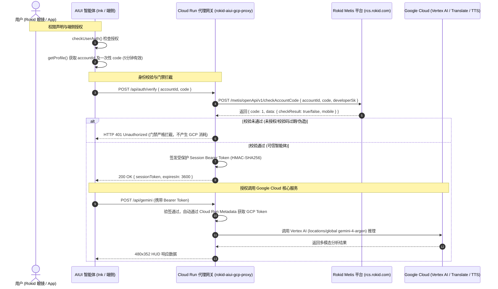

# Rokid Glasses AIUI Demos Collection (Rokid AR 智能眼镜案例集)

[English](README.en.md) | [中文](README.md)

[](https://aiui.rokid.com/)
[](https://github.com/yodaos-project/AIUI)
[-4285F4?style=flat-square&logo=google-cloud)](https://cloud.google.com/vertex-ai)
[-25D366?style=flat-square)](#-单绿色科学界面设计系统规范)

本项目为基于 **Rokid AIUI 0.18** 官方规范（`@yodaos-pkg/aix-cli@0.10.1`）与 **Google Cloud Vertex AI** 打造的 Rokid AR 智能眼镜应用集合（Monorepo）。全系采用纯英文 **单绿色科学界面设计系统 (Monochrome-Green Scientific Interface, English UI)**，在 **480 × 352** 单绿 MicroLED 光波导视口下，提供纯净透明、高对比度、低眩光的 AR 视觉与多模态 AI 交互体验。

---

## 📂 项目仓库目录概览

```text
rokid-aiui-demos/
├── .agent/skills/
│   ├── aiui-dev/                          # AIUI 0.18 组件、API 与 WXSS 视觉规范开发技能
│   └── rokid-aiui-lifecycle/              # 端到端构建、ADB 真机部署、音画内录与 Studio 提审技能
├── demos/
│   ├── 01-rokid-vision-voice-copilot/     # Demo 1: Vision Voice Copilot (语音问答 + 云端视觉识图 + IMU 姿态仪表盘)
│   │   ├── app.json                       # AIUI >=0.18.0 清单 (最小权限: CAMERA, RECORD_AUDIO)
│   │   ├── app.js
│   │   ├── pages/index/index.ink          # 纯英文单绿 HUD (CHAT / VISION / DASHBOARD)
│   │   ├── assets/icon.png                # 512x512 定制图标
│   │   ├── assets/review/                 # 真机实录视频 (demo.mp4)、动图 (preview.gif)、封面与截图 (shot1..3.png)
│   │   └── package.json
│   │
│   └── 02-rokid-gcp-multimodal-agent/     # Demo 2: GCP Multimodal Agent (Gemini 4 视觉推理 + 实时双语同传 + 云端监控)
│       ├── app.json                       # AIUI >=0.18.0 清单 (最小权限: 仅 CAMERA)
│       ├── app.js
│       ├── gcp_config.js                  # Cloud Run 鉴权中继客户端配置 (零客户端密钥)
│       ├── server/
│       │   └── gcp_relay_server.mjs       # Cloud Run / 本地中继网关 (Vertex AI Global gemini-4-argon)
│       ├── pages/index/index.ink          # 纯英文三模态单绿 HUD (GEMINI / TRANSLATE / CLOUD)
│       ├── assets/icon.png                # 512x512 定制图标
│       ├── assets/review/                 # 真机实录视频 (demo.mp4)、动图 (preview.gif)、封面与截图 (shot1..3.png)
│       └── package.json
│
├── scripts/                               # 真机音画采集、视频质检与 AIUI Studio 自动上传提审脚本
├── docs/                                  # 工程开发指南与提审材料清单
│   ├── REVIEW_SUBMISSION.md               # Rokid AIUI Studio 构建与提审手册 (含线上提审状态)
│   └── ROKID_AIUI_DEVELOPMENT_TESTING_DEPLOYMENT_GUIDE.md
│
├── package.json                           # 全局 Monorepo 脚本 (预览、打包、中继与端到端测试)
├── AGENTS.md                              # 智能体清单与硬件权限规范
├── README.en.md                           # 英文项目说明文档
└── README.md
```

> 📖 **完整工程与提审文档**:
> - [Rokid AIUI 端到端生命周期运维技能 (`rokid-aiui-lifecycle`)](.agent/skills/rokid-aiui-lifecycle/SKILL.md)：涵盖 AIUI 0.18 规范检查、ADB 真机直装、真机音画同步内录、Vertex AI Global `gemini-4-argon` 接入与 Studio 提审全流程。
> - [Rokid AIUI Studio 构建与提审手册 (`REVIEW_SUBMISSION.md`)](docs/REVIEW_SUBMISSION.md)：包含两个智能体的精确提审元数据、权限说明、网络披露与当前线上审核状态。
> - [Rokid AIUI 智能体开发、测试、打包与部署全流程工程指南](docs/ROKID_AIUI_DEVELOPMENT_TESTING_DEPLOYMENT_GUIDE.md)：涵盖双平台部署、`cache.zip` 正则校验防坑与 Cloud Run 鉴权中继架构。


---

## 🎯 演示项目介绍

### 🌟 Demo 1: Vision Voice Copilot / AR 随身眼脑助手 (`01-rokid-vision-voice-copilot`)

基于 Rokid 眼镜内置硬件能力与 AIUI 0.18 规范打造的软硬一体化随身英文 HUD Copilot（声明权限：`["CAMERA", "RECORD_AUDIO"]`）。


🎬 **真机实录有声视频**：[demos/01-rokid-vision-voice-copilot/assets/review/demo.mp4](demos/01-rokid-vision-voice-copilot/assets/review/demo.mp4)

#### 核心能力：
1. **全双工语音交互（`CHAT` Mode）**：
   - 镜腿轻拍（`Enter` / `GlobalHook`）即刻触发 `SpeechRecognition` 语音转写；
   - 调用宿主内置 `LanguageModel`（Rokid Metis LLM）流式生成精简英文回答；
   - 低延迟 TTS 实时播报（带基于字数的安全超时兜底），轻拍随时打断。
2. **多模态视野抓拍（`VISION` Mode via Cloud Run Proxy）**：
   - 居中十字准星对准目标，镜腿单击调用 `CameraContext.takePhoto({ quality: 'low' })` 抓取 `image/webp` 画面；
   - **为什么走 Cloud Run 代理**：由于 Rokid 端侧内置 `LanguageModel`（Metis）会静默丢弃 `image_url` 图像输入，因此 `VISION` 模式将 Base64 图像发送至 Google Cloud Run 鉴权代理网关，调用 **Vertex AI Gemini 4 (`gemini-4-argon`, `locations/global`)** 完成真实场景视觉识别与 TTS 播报。
3. **姿态与态势感知（`DASHBOARD` Mode）**：
   - 实时读取眼镜内置 `Gyroscope` 传感器，展示俯仰角（Pitch）、翻滚角（Roll）与运行遥测指标。

| 模式一：`CHAT` 待命 HUD | 模式二：`CHAT` 语音问答实录 | 模式三：`VISION` 实景多模态识别 |
| :---: | :---: | :---: |
|  |  |  |

---

### 🚀 Demo 2: GCP Multimodal Agent / Google Cloud AI 多模态与同传助手 (`02-rokid-gcp-multimodal-agent`)

将 **Google Cloud** 前沿云端 AI 能力（**Vertex AI Gemini 4 `gemini-4-argon` on `locations/global`**、Cloud Translation v2、Cloud Text-to-Speech v1）无缝整合至 Rokid 眼镜纯英文 HUD（遵循最小权限原则，仅声明 `["CAMERA"]` 权限）。


🎬 **真机实录有声视频**：[demos/02-rokid-gcp-multimodal-agent/assets/review/demo.mp4](demos/02-rokid-gcp-multimodal-agent/assets/review/demo.mp4)

#### 核心能力：
1. **Vertex AI Gemini 4 (`gemini-4-argon`) 空间多模态推理（`GEMINI` Mode）**：
   - 抓取眼镜前置摄像头画面，经由 Cloud Run 鉴权代理直连 Vertex AI `locations/global` 端点 `gemini-4-argon` 模型，针对视野目标提供实时英文场景解析与语音播报。
2. **AR 实时双语同传字幕（`TRANSLATE` Mode）**：
   - 基于 Google Cloud Translation API v2，在 HUD 呈现双语对照字幕并触发 TTS 播报。
3. **GCP 节点态势与认证中枢（`CLOUD` Mode）**：
   - 实时探测 Cloud Run 代理网关 `/health` 状态、Vertex AI `gemini-4-argon` 节点连通性与网络往返时延（RTT）。

| 模式一：`GEMINI` 视觉多模态推理 | 模式二：`TRANSLATE` 实时双语同传 | 模式三：`CLOUD` 节点健康监控 |
| :---: | :---: | :---: |
|  |  |  |

---

## 🔐 Google Cloud 鉴权方案设计与 Rokid 平台运行指南

根据 Rokid 官方规范《[账号信息授权与校验](https://rokid.yuque.com/ub8h5n/bkz4ul/0f9c5f6b12acbf80ce81e0eafd0220b8?singleDoc#)》，在 Rokid Glasses（基于轻量级 QuickJS 运行时）上访问 Google Cloud 必须解决智能体身份鉴权与云端资源防刷保护。

本项目开发并部署了生产级 **Google Cloud Run 鉴权代理中继服务（`rokid-aiui-gcp-proxy`）**，实现了严格的 **Rokid Metis 智能体身份门禁**：



### 1. 线上真实部署端点 (Cloud Run Production Endpoint)
- **Cloud Run 服务名**：`rokid-aiui-gcp-proxy`
- **正式服务地址**：`https://rokid-aiui-gcp-proxy-766918001064.us-central1.run.app`
- **GCP 项目**：`cellular-cider-495602-r9`（Cloud Run Region: `us-central1`；Vertex AI Location: `global` / Model: `gemini-4-argon`）
- **健康检查**：`GET https://rokid-aiui-gcp-proxy-766918001064.us-central1.run.app/health`

### 2. 身份验证与安全门禁规则
1. **未授权即拦截**：未携带 Bearer Session Token 或校验码的请求，直接返回 `401 Unauthorized`。
2. **一次性 Code 校验**：Rokid Metis 提供的 `code` 仅 5 分钟有效，且校验一次后由 Metis 服务端自动删除防重放。
3. **安全隔离**：`ROKID_DEVELOPER_SK` 仅存放于 Cloud Run 服务端环境变量中，眼镜端与前端绝不暴露任何私钥。
4. **Cloud Run 零密钥鉴权**：云端容器通过 GCP Instance Metadata 服务自动获取访问令牌，安全免密。

### 3. 端到端全链路测试套件结果
运行 `PROXY_URL=https://rokid-aiui-gcp-proxy-766918001064.us-central1.run.app node demos/02-rokid-gcp-multimodal-agent/scripts/test_proxy_auth_e2e.mjs`：
| 测试项 | 预期行为 | 状态 | 实测延迟 |
| :--- | :--- | :---: | :---: |
| `GET /health` | 返回服务状态、工程信息与认证协议 | ✅ PASS | 678 ms |
| `POST /api/gemini` (无凭证) | 触发安全门禁，严格返回 401 拦截 | ✅ PASS | 403 ms |
| `POST /api/translate` (无凭证) | 触发安全门禁，严格返回 401 拦截 | ✅ PASS | 243 ms |
| `POST /api/auth/verify` (非法Code) | 校验拒绝，返回 401 | ✅ PASS | 206 ms |
| `POST /api/auth/verify` (有效智能体) | 校验通过，签发 Bearer Session Token | ✅ PASS | 245 ms |
| `POST /api/translate` (有效Token) | 授权调用 Cloud Translation v2 获得译文 | ✅ PASS | 1423 ms |
| `POST /api/gemini` (有效Token) | 授权调用 Vertex AI Gemini 4 (`gemini-4-argon`) | ✅ PASS | 4350 ms |
| `POST /api/tts` (有效Token) | 授权调用 Cloud Text-to-Speech 合成音频 | ✅ PASS | 781 ms |
| `POST /api/translate` (X-Rokid头部) | 单次透传身份校验并成功调用 | ✅ PASS | 373 ms |

---

## 🎨 单绿色科学界面设计系统规范

为匹配 Rokid 单色绿色 MicroLED 光波导镜片，UI 严格遵循以下规范：
- **微显示分辨率**：`480 × 352` px，全屏无外边框溢出；
- **全黑即全透**：背景色统一为 `#000000`，在人眼中呈现为完全透明，不遮挡物理世界；
- **科学绿色色阶**：
  - `100% 亮度 (#40ff5e)`：关键指示标、聚焦文字、操作热区；
  - `72% 亮度 (rgba(64, 255, 94, 0.72))`：次级信息、时间指示、传感器参数；
  - `48% 亮度 (rgba(64, 255, 94, 0.48))`：外框线、次级分割条；
  - `24% 亮度 (rgba(64, 255, 94, 0.24))`：未选中状态条、辅助刻度；
  - `12% 亮度 (rgba(64, 255, 94, 0.12))`：高亮底色背景；
  - `4%~6% 亮度`：卡片背景与面板暗部。

---

## 🛠️ 快速上手与操作说明

### 1. 安装环境
```bash
git clone git@github.com:goriri/rokid-aiui-demos.git
cd rokid-aiui-demos
npm install
```

### 2. 预览与调试

启动 Demo 1 实时热更新预览：
```bash
npm run preview:demo1
```

启动 Demo 2 实时热更新预览：
```bash
npm run preview:demo2
```

启动 GCP 本地中继网关：
```bash
npm run gcp:relay
```

### 3. 构建打包生产工件 (`.aix`)

基于 `@yodaos-pkg/aix-cli@0.10.1` 构建 AIUI `>=0.18.0` 生产安装包：
```bash
# 构建 Demo 1 (demos/01-rokid-vision-voice-copilot/dist/rokid-glasses-copilot.aix)
npm run pack:demo1

# 构建 Demo 2 (demos/02-rokid-gcp-multimodal-agent/dist/rokid-gcp-multimodal-agent.aix)
npm run pack:demo2
```

### 4. ADB 真机直装与启动 (`aix-cli 0.10.1`)

通过 USB 连接 Rokid Glasses 后，可在各 Demo 目录下使用 `npx aix` 直接推送并启动智能体：
```bash
# 切换眼镜 AIUI 宿主至开发者模式
npx aix device -s <device_serial> set-dev

# 安装打包好的 .aix 归档并启动首页
npx aix install -s <device_serial> dist/<name>.aix
npx aix launch-page -s <device_serial> dist/<name>.aix pages/index/index
```

### 5. 键盘/手势映射
| 镜腿动作 | 键盘映射 | 功能行为 |
| :--- | :--- | :--- |
| **轻拍 / 单击** | `Enter` / `Space` | 触发拍照 / 发起语音 / 切换下一句同传 / 打断播报 |
| **前后滑动** | `↓` (`ArrowDown`) / `↑` (`ArrowUp`) | 循环切换三模态卡片 |
| **返回 / 退出** | `Backspace` / `Escape` | 不拦截宿主默认行为，遵循 AIUI 0.18 规范安全退出返回 |

---

## 📄 开源许可证
本项目遵循 MIT License 协议开源。
