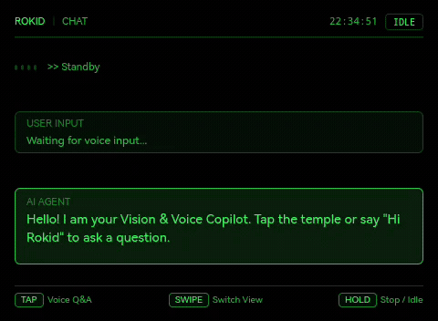
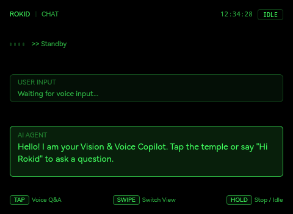
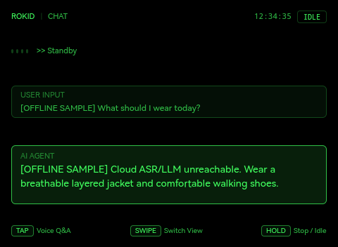
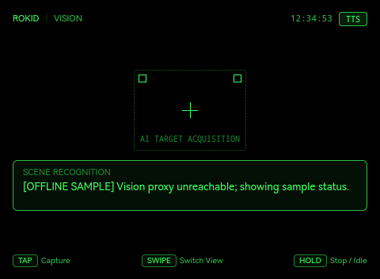
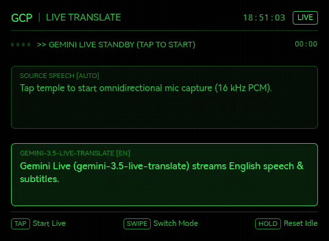
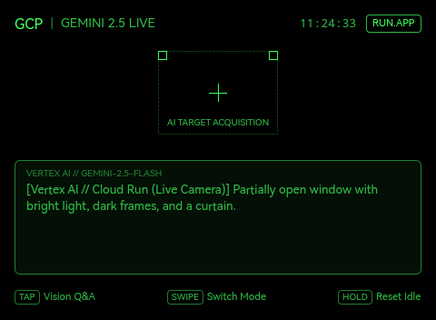
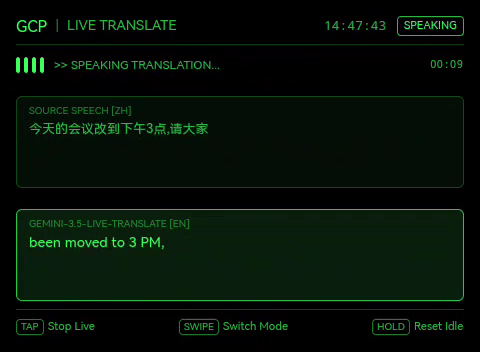
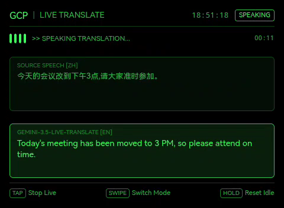

# Rokid Glasses AIUI Demos Collection (Rokid AR 智能眼镜案例集)

[English](README.en.md) | [中文](README.md)

[](https://aiui.rokid.com/)
[](https://github.com/yodaos-project/AIUI)
[-4285F4?style=flat-square&logo=google-cloud)](https://cloud.google.com/vertex-ai)
[-25D366?style=flat-square)](#-单绿色科学界面设计系统规范)

本项目为基于 **Rokid AIUI 0.18** 官方规范（`@yodaos-pkg/aix-cli@0.10.1`）与 **Google Cloud Vertex AI** 打造的 Rokid AR 智能眼镜应用集合（Monorepo）。全系采用纯英文 **单绿色科学界面设计系统 (Monochrome-Green Scientific Interface, English UI)**，在 **480 × 352** 单绿 MicroLED 光波导视口下，提供纯净透明、高对比度、低眩光的 AR 视觉、实时语音同传与多模态 AI 交互体验。

---

## 📂 项目仓库目录概览

```text
rokid-aiui-demos/
├── .agent/skills/
│   ├── aiui-dev/                          # AIUI 0.18 组件、API 与 WXSS 视觉规范开发技能
│   └── rokid-aiui-lifecycle/              # 端到端构建、ADB 真机部署、音画内录与 Studio 提审技能
├── demos/
│   ├── 01-rokid-vision-voice-copilot/     # Demo 1: Vision Voice Copilot (语音问答 + 云端视觉识图 + IMU 姿态仪表盘)
│   │   ├── app.json                       # AIUI >=0.18.0 清单 (权限: CAMERA, RECORD_AUDIO)
│   │   ├── app.js
│   │   ├── pages/index/index.ink          # 纯英文单绿 HUD (CHAT / VISION / DASHBOARD)
│   │   ├── assets/icon.png                # 512x512 定制图标
│   │   ├── assets/review/                 # 真机实录视频 (demo.mp4)、动图 (preview.gif)、封面 (cover.png) 与截图 (shot1..3.png)
│   │   └── package.json
│   │
│   └── 02-rokid-gcp-multimodal-agent/     # Demo 2: GCP Live Translator v1.0.12 (Gemini Live 实时语音同传 + Gemini 4 视觉 + 云端监控)
│       ├── app.json                       # AIUI >=0.18.0 清单 (权限: CAMERA, RECORD_AUDIO)
│       ├── app.js
│       ├── gcp_config.js                  # Cloud Run HTTP + WebSocket 鉴权中继配置 (零客户端密钥)
│       ├── server/
│       │   └── gcp_relay_server.mjs       # Cloud Run 网关 (Vertex AI Global gemini-4-argon + gemini-3.5-live-translate-preview)
│       ├── scripts/                       # 端到端与云端验证脚本 (test_gemini_image.mjs, test_live_translate.mjs, test_proxy_auth_e2e.mjs)
│       ├── pages/index/index.ink          # 纯英文三模态单绿 HUD (GEMINI 4 LIVE / LIVE TRANSLATE / CLOUD CONSOLE)
│       ├── assets/icon.png                # 512x512 定制图标
│       ├── assets/review/                 # 真机实录视频 (demo.mp4)、动图 (preview.gif)、封面 (cover.png) 与截图 (shot1..3.png)
│       └── package.json
│
├── scripts/                               # AIUI Studio 自动打包上传、创建新智能体 (--create) 与提审脚本
├── docs/                                  # 工程开发指南与提审材料清单
│   ├── REVIEW_SUBMISSION.md               # Rokid AIUI Studio 构建与提审手册 (含三个线上智能体状态)
│   └── ROKID_AIUI_DEVELOPMENT_TESTING_DEPLOYMENT_GUIDE.md
│
├── package.json                           # 全局 Monorepo 脚本 (预览、打包、中继与端到端测试)
├── AGENTS.md                              # 智能体清单与硬件权限规范
├── README.en.md                           # 英文项目说明文档
└── README.md
```

> 📖 **完整工程与提审文档**:
> - [Rokid AIUI 端到端生命周期运维技能 (`rokid-aiui-lifecycle`)](.agent/skills/rokid-aiui-lifecycle/SKILL.md)：涵盖 AIUI 0.18 规范检查、ADB 真机直装、far-field 前向拾音与 WebSocket 音频流、真机音画同步内录、Vertex AI Global 模型接入与 Studio 提审全流程。
> - [Rokid AIUI Studio 构建与提审手册 (`REVIEW_SUBMISSION.md`)](docs/REVIEW_SUBMISSION.md)：包含 `GCP Live Translator`（主线最新）等三个智能体的精确提审元数据、权限用途、数据披露与当前线上审核状态。
> - [Rokid AIUI 智能体开发、测试、打包与部署全流程工程指南](docs/ROKID_AIUI_DEVELOPMENT_TESTING_DEPLOYMENT_GUIDE.md)：涵盖 Gemini Live WebSocket 同传中继协议、`cache.zip` 正则校验防坑与 Cloud Run 无流量标签灰度发布。

---

## 📊 Rokid AIUI Studio 线上提审状态

| 智能体名称 (`agentName`) | 源码目录 / 版本说明 | Studio `agentId` | 线上 `reviewNativeVersion` | 状态 (`displayStatus`) |
| :--- | :--- | :--- | :---: | :---: |
| **Vision Voice Copilot** | `demos/01-rokid-vision-voice-copilot` | `059b26f3ffcd47ab8280a2d176b0f88a` | `1.0.9` | `checking` |
| **GCP Multimodal Agent** | `demos/02-rokid-gcp-multimodal-agent` (历史快照 `git 099e5fb`) | `68e11a45486e4b279704e1e3c43b4b4b` | `1.0.8` | `checking` |
| **GCP Live Translator** | `demos/02-rokid-gcp-multimodal-agent` (当前主线包 `v1.0.12`) | `48c2e202270c469886dde77ef1ecc936` | `1.0.4` (= package `v1.0.12`) | `checking` |

> 💡 **关于 `nativeVersion` 自动递增**：Rokid AIUI Studio 后端每次保存（`updateThirdAgent`）会自动将线上 `nativeVersion` 递增 `+0.0.1`（新建智能体通过 `--create` / `saveAIUIAgent` 从 `1.0.0` 起步）。自动化上传脚本 [`scripts/studio_upload.mjs`](scripts/studio_upload.mjs) 支持 `--dry-run`（默认只读预览）、`--execute`（实网上传并单次保存）以及 `--create`（创建全新智能体并关联提审路径）。

---

## 🎯 演示项目介绍

### 🌟 Demo 1: Vision Voice Copilot / AR 随身眼脑助手 (`01-rokid-vision-voice-copilot`)

基于 Rokid 眼镜内置硬件能力与 AIUI 0.18 规范打造的软硬一体化随身英文 HUD Copilot（声明权限：`["CAMERA", "RECORD_AUDIO"]`）。



🎬 **真机实录有声视频与提审素材**：
- 演示视频：[demos/01-rokid-vision-voice-copilot/assets/review/demo.mp4](demos/01-rokid-vision-voice-copilot/assets/review/demo.mp4)
- 1080×1080 封面图：[demos/01-rokid-vision-voice-copilot/assets/review/cover.png](demos/01-rokid-vision-voice-copilot/assets/review/cover.png)

#### 核心能力：
1. **全双工语音交互（`CHAT` Mode）**：
   - 镜腿轻拍（`Enter` / `GlobalHook`）即刻触发 `SpeechRecognition` 语音转写；
   - 调用宿主内置 `LanguageModel`（Rokid Metis LLM）流式生成精简英文回答；
   - 低延迟 TTS 实时播报（带基于字数的安全超时兜底），轻拍随时打断。
2. **多模态视野抓拍（`VISION` Mode via Cloud Run Proxy）**：
   - 居中十字准星对准目标，镜腿单击调用 `CameraContext.takePhoto({ quality: 'low' })` 抓取 `image/webp` 画面；
   - **为什么走 Cloud Run 代理**：由于 Rokid 端侧内置 `LanguageModel`（Metis）会静默丢弃 `image_url` 图像输入，因此 `VISION` 模式将 Base64 图像发送至 Google Cloud Run 鉴权代理网关，调用 **Vertex AI Gemini 4 (`gemini-4-argon`, `locations/global`)** 完成真实场景视觉识别与 TTS 播报。
3. **姿态与态势感知（`DASHBOARD` Mode）**：
   - 实时读取眼镜内置 `Gyroscope` 传感器，展示俯仰角（Pitch）、翻滚角（Roll）与运行遥测指标。

| 模式一：`CHAT` 待命 HUD | 模式二：`CHAT` 语音问答实录 | 模式三：`VISION` 实景多模态识别 |
| :---: | :---: | :---: |
|  |  |  |

---

### 🚀 Demo 2: GCP Live Translator / Google Cloud 实时语音同传与多模态助手 (`02-rokid-gcp-multimodal-agent`, v1.0.12)

将 **Google Cloud Vertex AI** 实时双向音频同传（**`gemini-3.5-live-translate-preview` on `locations/global`**）与前沿视觉推理（**Gemini 4 `gemini-4-argon` on `locations/global`**）整合至 Rokid 眼镜 480×352 纯英文单绿 HUD（声明权限：`["CAMERA", "RECORD_AUDIO"]`）。



🎬 **真机实录有声视频与提审素材**：
- 演示视频：[demos/02-rokid-gcp-multimodal-agent/assets/review/demo.mp4](demos/02-rokid-gcp-multimodal-agent/assets/review/demo.mp4)
- 1080×1080 封面图：[demos/02-rokid-gcp-multimodal-agent/assets/review/cover.png](demos/02-rokid-gcp-multimodal-agent/assets/review/cover.png)

#### 核心能力：
1. **Gemini Live 实时语音到语音同传（`LIVE TRANSLATE` Mode）**：
   - **数据链路**：眼镜前向远场麦克风（`navigator.mediaDevices.getUserMedia` 配置 `microphoneMode: 'far-field'`，通过 `MediaRecorder` `audio/wav` 提取 16 kHz 单声道 PCM16 分片，`0.7` 增益限幅）→ 鉴权 WebSocket → Cloud Run `/ws/live-translate` → **Vertex AI Global `gemini-3.5-live-translate-preview`**（自动识别源语言 → 英语）→ 下行 **24 kHz PCM** 英文同传语音（通过 `AudioContext.createBuffer(1, n, 24000)` 无缝排期播放）+ HUD 实时双语字幕（`input_transcript` 附带检测到的源语言标签 + `output_transcript` 英文字幕）；
   - **拾音、说话暂缓播报与抖动缓冲**：`far-field` 波束成形聚焦正前方说话人，抑制两侧环境人声与镜腿扬声器（实测环境峰值从 16k–23k 降至 0–7.7k）；说话人正在发言时暂缓播报（基于自适应噪底的 VAD，700ms 尾音保持 hangover），停顿后从抖动缓冲区（0.8s 预缓冲，6s 安全上限）平滑连续播放；上行仅在眼镜自身播报期间静音（半双工 half-duplex），且 `echoTargetLanguage=false`；
   - **会话控制與零示例兜底**：镜腿轻拍开始/停止同传；单次会话在 **4:50（290s）** 自动优雅停止（低于服务端 5:00 上限）；已彻底移除固定示例句与文本翻译降级路径，网络或鉴权异常时明确显示 `LIVE TRANSLATION UNAVAILABLE · <reason>`。
2. **Vertex AI Gemini 4 (`gemini-4-argon`) 实拍视觉问答（`GEMINI 4 LIVE` Mode）**：
   - 镜腿轻拍触发 `CameraContext.takePhoto({ quality: 'normal' })`（**12 秒超时**），将实拍画面经由 Cloud Run `/api/gemini` 发送至 **Vertex AI Global `gemini-4-argon`** 进行空间场景解析与语音播报；
   - **真实图像门禁**：若相机不可用或抓拍未返回图像，HUD 立即提示 `"Camera unavailable · tap to retry"`（状态标 `NO CAM`），**绝不**在无照片情况下请求大模型编造场景。
3. **GCP 节点态势与认证中枢（`CLOUD CONSOLE` Mode）**：
   - 实时探测 Cloud Run 代理网关 `/health` 状态、Rokid Metis 鉴权状态、GCP 项目信息与 Vertex AI 节点连通性。

#### 已知限制 (Known Limits)：
- **拾音范围**：`far-field` 模式聚焦正前方说话人，但正前方或较响的旁人语音仍可能被一并翻译，建议在相对安静、正对说话人的场景使用（若设备不支持 far-field 自动回退 `omnidirectional`）；
- **网络链路依赖**：眼镜端需保持**手机伴侣 App 蓝牙数据通道**连接或已配置 **Wi-Fi** 方可访问 Cloud Run；
- **首包语音延迟**：经由手机蓝牙代理转发时，端到端首包同传语音延迟约为 **~4 秒**（含上游 Gemini Live 推理与蓝牙链路传输）。

| 模式一：`GEMINI 4 LIVE` 视觉多模态推理 | 模式二：`LIVE TRANSLATE` 实时语音同传 | 模式三：`CLOUD CONSOLE` 节点健康监控 |
| :---: | :---: | :---: |
|  |  |  |

---

## 🔐 Google Cloud 鉴权方案设计与 Rokid 平台运行指南

根据 Rokid 官方规范《[账号信息授权与校验](https://rokid.yuque.com/ub8h5n/bkz4ul/0f9c5f6b12acbf80ce81e0eafd0220b8?singleDoc#)》，在 Rokid Glasses（基于轻量级 QuickJS 运行时）上访问 Google Cloud 必须解决智能体身份鉴权与云端资源防刷保护。

本项目开发并部署了生产级 **Google Cloud Run 鉴权代理中继服务（`rokid-aiui-gcp-proxy`）**，实现了严格的 **Rokid Metis 智能体身份门禁**，同时承载 HTTP 多模态推理与 WebSocket 实时双向语音同传：

```mermaid
sequenceDiagram
    autonumber
    actor User as 用户 / 周围说话人
    participant Agent as AIUI 智能体 (Rokid Glasses HUD)
    participant Proxy as Cloud Run 代理网关 (rokid-aiui-gcp-proxy)
    participant Metis as Rokid Metis 平台 (rcs.rokid.com)
    participant GCP as Google Cloud Vertex AI (locations/global)

    Note over User,Agent: 权限声明与端侧授权 (CAMERA + RECORD_AUDIO)
    Agent->>Proxy: POST /api/auth/verify { accountId, code }
    Proxy->>Metis: POST /metis/openApi/v1/checkAccountCode { accountId, code, developerSk }
    Metis-->>Proxy: 返回 { code: 1, data: { checkResult: true, mobile } }
    Proxy-->>Agent: 200 OK { sessionToken (HMAC-SHA256 Bearer, 1h TTL) }

    alt 模式一：GEMINI 4 LIVE 拍照视觉问答 (轻拍触发, 12s 拍照超时)
        User->>Agent: 轻拍镜腿抓拍实景照片
        Agent->>Proxy: POST /api/gemini (Bearer Token + Base64 图像)
        Proxy->>GCP: gemini-4-argon:generateContent (locations/global)
        GCP-->>Proxy: 场景解析文本
        Proxy-->>Agent: 480x352 HUD 响应 + TTS 播报
    else 模式二：LIVE TRANSLATE 实时语音同传 (4:50 自动停止)
        User->>Agent: 轻拍启动前向远场麦 (far-field 16kHz PCM16)
        Agent->>Proxy: WSS /ws/live-translate?token=<Bearer>&target=en
        Proxy->>GCP: BidiGenerateContent setup (gemini-3.5-live-translate-preview)
        loop 双向实时流 (VAD 暂缓播报 + 0.8s 抖动缓冲, 播报期半双工静音上行)
            Agent->>Proxy: Binary 16kHz PCM16 音频分片
            Proxy->>GCP: realtimeInput.audio (audio/pcm;rate=16000)
            GCP-->>Proxy: 24kHz 英文语音分片 + 源/目标流式字幕
            Proxy-->>Agent: Binary 24kHz PCM16 + JSON input/output_transcript
        end
    end
```

### 1. 线上真实部署端点 (Cloud Run Production Endpoint)
- **Cloud Run 服务名**：`rokid-aiui-gcp-proxy`
- **正式服务地址**：`https://rokid-aiui-gcp-proxy-766918001064.us-central1.run.app`
- **当前生效版本 (Active Revision)**：`rokid-aiui-gcp-proxy-00006-vin`（承载 **100% 流量**，支持 `/ws/live-translate`、`/api/gemini`、`/api/auth/verify`、`/api/translate`、`/api/tts`、`/health`；历史版本 `00001`–`00003` 保留用于快速回滚）
- **GCP 项目与模型**：`cellular-cider-495602-r9`（Cloud Run Region: `us-central1`；Vertex AI Location: `global`；视觉模型：`gemini-4-argon`；同传模型：`gemini-3.5-live-translate-preview`）
- **健康检查**：`GET https://rokid-aiui-gcp-proxy-766918001064.us-central1.run.app/health`

### 2. 身份验证与安全门禁规则
1. **未授权即拦截**：未携带有效 Bearer Session Token 或校验码的 HTTP 请求与 WebSocket 升级握手，直接返回 `401 Unauthorized`，不会建立上游 Vertex AI 会话。
2. **一次性 Code 校验**：Rokid Metis 提供的 `code` 仅 5 分钟有效，且校验一次后由 Metis 服务端自动删除防重放。
3. **安全隔离**：`ROKID_DEVELOPER_SK` 仅存放于 Cloud Run 服务端环境变量中，眼镜端与前端绝不暴露任何私钥。
4. **Cloud Run 零密钥鉴权**：云端容器通过 GCP Instance Metadata 服务自动获取访问令牌，安全免密。

### 3. 端到端全链路测试套件结果
可通过以下三条宿主机测试命令验证线上 Cloud Run 代理的鉴权门禁、Gemini 4 视觉推理与 Gemini Live 语音同传：
```bash
# 1. 鉴权门禁与 REST 路由全链路测试
npm run test:proxy

# 2. Vertex AI Global gemini-4-argon 真实图像推理测试
node demos/02-rokid-gcp-multimodal-agent/scripts/test_gemini_image.mjs

# 3. Vertex AI Global gemini-3.5-live-translate-preview WebSocket 语音同传测试
node demos/02-rokid-gcp-multimodal-agent/scripts/test_live_translate.mjs
```

| 测试项 | 预期行为 | 状态 | 实测延迟 |
| :--- | :--- | :---: | :---: |
| `GET /health` | 返回服务状态、工程信息与 `gemini-4-argon` 模型标识 | ✅ PASS | 678 ms |
| `POST /api/gemini` (无凭证) | 触发安全门禁，严格返回 401 拦截 | ✅ PASS | 403 ms |
| `WSS /ws/live-translate` (无凭证) | WebSocket 握手门禁拦截，返回 401 | ✅ PASS | ~220 ms |
| `POST /api/auth/verify` (非法Code) | 校验拒绝，返回 401 | ✅ PASS | 206 ms |
| `POST /api/auth/verify` (有效智能体) | 校验通过，签发 Bearer Session Token | ✅ PASS | 245 ms |
| `POST /api/gemini` (`test_gemini_image.mjs`) | 调用 Vertex AI Global `gemini-4-argon` 准确描述实拍图像 | ✅ PASS | ~4.3 s |
| `WSS /ws/live-translate` (`test_live_translate.mjs`) | 16 kHz 中文语音上行 → `gemini-3.5-live-translate-preview` → 24 kHz 英文语音 + 双语字幕下行 | ✅ PASS | ~3.0 s (首包音频) |
| `POST /api/translate` & `/api/tts` (有效Token) | 授权调用 Cloud Translation v2 与 Cloud TTS v1 | ✅ PASS | ~1.1 s |

---

## 🎨 单绿色科学界面设计系统规范

为匹配 Rokid 单色绿色 MicroLED 光波导镜片，UI 严格遵循以下规范：
- **微显示分辨率**：`480 × 352` px，全屏无外边框溢出；
- **全黑即全透**：背景色统一为 `#000000`，在人眼中呈现为完全透明，不遮挡物理世界；
- **科学绿色色阶**：
  - `100% 亮度 (#40ff5e)`：关键指示标、聚焦文字、操作热区；
  - `72% 亮度 (rgba(64, 255, 94, 0.72))`：次级信息、时间指示、传感器参数；
  - `48% 亮度 (rgba(64, 255, 94, 0.48))`：外框线、次级分割条；
  - `24% 亮度 (rgba(64, 255, 94, 0.24))`：未选中状态条、辅助刻度；
  - `12% 亮度 (rgba(64, 255, 94, 0.12))`：高亮底色背景；
  - `4%~6% 亮度`：卡片背景与面板暗部。

---

## 🛠️ 快速上手与操作说明

### 1. 安装环境
```bash
git clone git@github.com:goriri/rokid-aiui-demos.git
cd rokid-aiui-demos
npm install
```

### 2. 预览与调试

启动 Demo 1 实时热更新预览：
```bash
npm run preview:demo1
```

启动 Demo 2 实时热更新预览：
```bash
npm run preview:demo2
```

启动 GCP 本地中继网关：
```bash
npm run gcp:relay
```

### 3. 构建打包生产工件 (`.aix`)

基于 `@yodaos-pkg/aix-cli@0.10.1` 构建 AIUI `>=0.18.0` 生产安装包：
```bash
# 构建 Demo 1 (demos/01-rokid-vision-voice-copilot/dist/rokid-glasses-copilot.aix)
npm run pack:demo1

# 构建 Demo 2 (demos/02-rokid-gcp-multimodal-agent/dist/rokid-gcp-multimodal-agent.aix)
npm run pack:demo2
```

### 4. ADB 真机直装与启动 (`aix-cli 0.10.1`)

通过 USB 连接 Rokid Glasses 后，可在各 Demo 目录下使用 `npx aix` 直接推送并启动智能体：
```bash
# 切换眼镜 AIUI 宿主至开发者模式
npx aix device -s <device_serial> set-dev

# 安装打包好的 .aix 归档并启动首页
npx aix install -s <device_serial> dist/<name>.aix
npx aix launch-page -s <device_serial> dist/<name>.aix pages/index/index
```

### 5. 键盘/手势映射
| 镜腿动作 | 键盘映射 | 功能行为 |
| :--- | :--- | :--- |
| **轻拍 / 单击** | `Enter` / `Space` | 触发实景拍照 / 启动或停止 Gemini Live 实时语音同传 / 发起语音问答 / 打断播报 |
| **前后滑动** | `↓` (`ArrowDown`) / `↑` (`ArrowUp`) | 循环切换三模态卡片（切换时自动关闭活跃的同传会话并释放麦克风） |
| **返回 / 退出** | `Backspace` / `Escape` | 自动释放同传会话资源，不拦截宿主默认行为，遵循 AIUI 0.18 规范安全退出返回 |

---

## 📄 开源许可证
本项目遵循 MIT License 协议开源。
