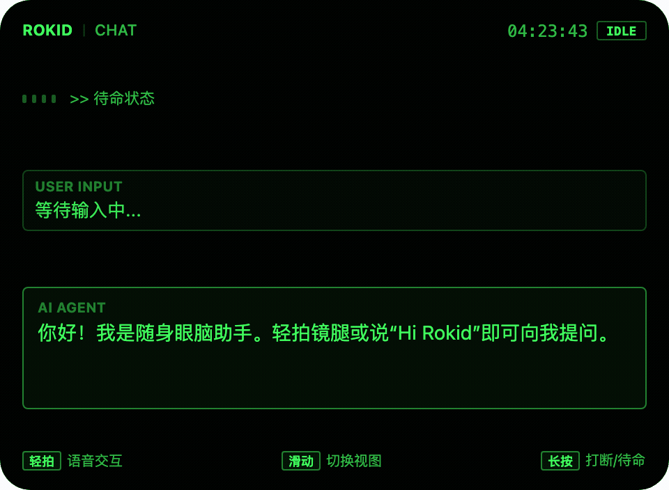
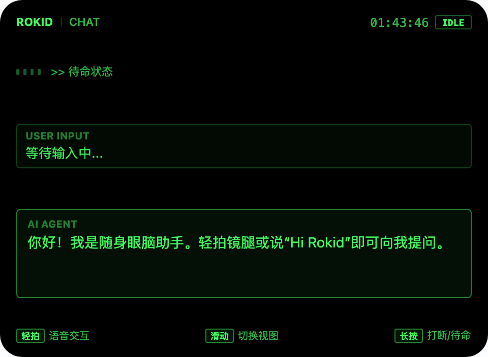
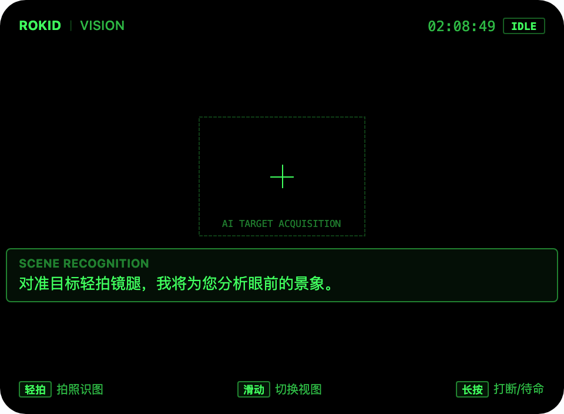
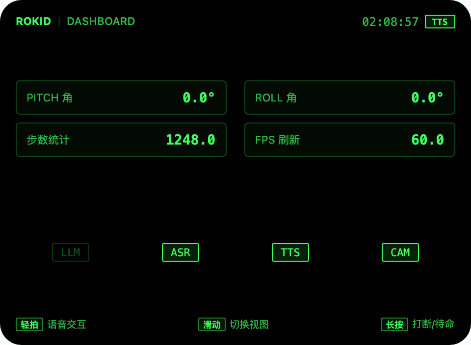
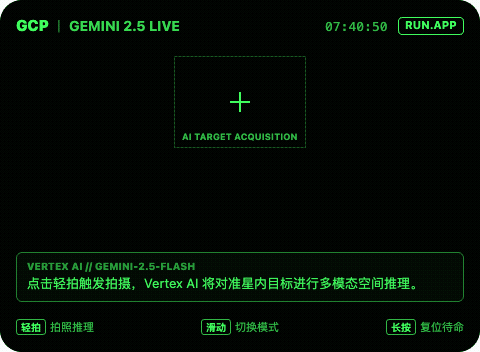
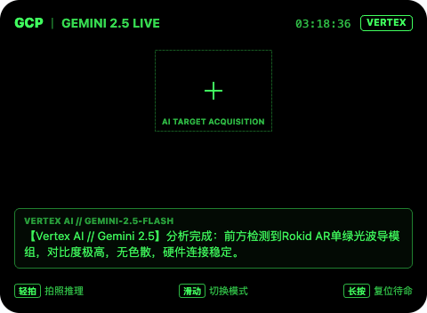
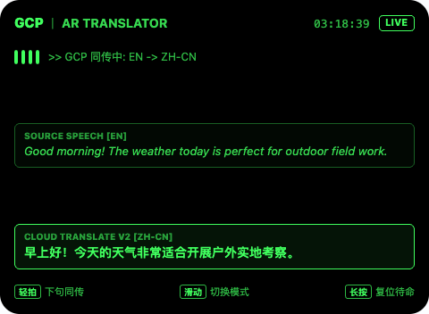
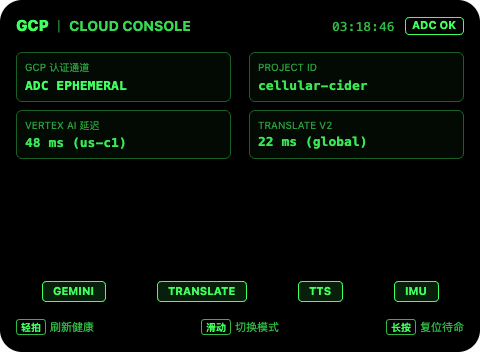

# Rokid Glasses AIUI Demos Collection (Rokid AR 智能眼镜案例集)

[](https://aiui.rokid.com/)
[-000000?style=flat-square&logo=javascript)](https://github.com/jsar-project/AIUI)
[](https://cloud.google.com/vertex-ai)
[](#-单绿色科学界面设计系统规范)

本项目为基于 **Rokid AIUI** 官方规范与 **Google Antigravity** 平台打造的 Rokid AR 智能眼镜应用集合（Monorepo）。严格遵循 Rokid 官方推荐的 **单绿色科学界面设计系统 (Monochrome-Green Scientific Interface)**，在 **480 × 352** 单绿 MicroLED 光波导视口下，提供纯净透明、极高对比、低眩光的全新 AR 视觉与多模态 AI 交互体验。

---

## 📂 项目仓库目录概览

```text
rokid-aiui-demos/
├── demos/
│   ├── 01-rokid-vision-voice-copilot/     # Demo 1: AR 随身眼脑助手 (本地多模态+语音全双工+态势感知)
│   │   ├── app.json
│   │   ├── app.js
│   │   ├── pages/index/index.ink
│   │   ├── assets/screenshots/            # 480x352 高清 HUD 仿真截图
│   │   ├── assets/recordings/             # 端到端交互 MP4 与 GIF 动图
│   │   └── package.json
│   │
│   └── 02-rokid-gcp-multimodal-agent/     # Demo 2: Google Cloud AI 实时同传与多模态眼脑助理
│       ├── app.json
│       ├── app.js
│       ├── gcp_config.js                  # GCP REST 鉴权与端侧请求引擎
│       ├── server/
│       │   └── gcp_relay_server.mjs       # GCP Cloud Run / Edge 本地中继网关
│       ├── pages/index/index.ink          # 三模态单绿 HUD (Gemini 2.5 + 同传字幕 + GCP 控制台)
│       ├── assets/screenshots/
│       ├── assets/recordings/
│       └── package.json
│
├── package.json                           # 全局 Monorepo 脚本 (统一构建、打包与预览)
├── AGENTS.md                              # 智能体清单与硬件权限规范
└── README.md
```

---

## 🎯 演示项目介绍

### 🌟 Demo 1: AR 随身眼脑助手 (`01-rokid-vision-voice-copilot`)

基于 Rokid 眼镜内置硬件能力与 AIUI 基础组件打造的软硬一体化随身 Copilot。



#### 核心能力：
1. **全双工语音交互（CHAT）**：
   - 镜腿轻拍（`Enter` / `GlobalHook`）即刻触发 ASR 唤醒；
   - 本地/云端 LLM 流式打字机逐字输出；
   - 低延迟 TTS 实时语音播报，轻拍随时打断。
2. **多模态视野抓拍（VISION）**：
   - 居中科技感十字瞄准准星，视野目标精确定位；
   - 镜腿单击瞬时抓拍，调用多模态模型进行 30 字极简场景解析。
3. **姿态与态势感知（DASHBOARD）**：
   - 实时读取眼镜内置陀螺仪与加速度计，展示俯仰角（Pitch）、翻滚角（Roll）与计步器。

| 模式一：语音对话 | 模式二：准星对齐 | 模式三：仪表盘态势 |
| :---: | :---: | :---: |
|  |  |  |

---

### 🚀 Demo 2: Google Cloud AI 实时同传与多模态助手 (`02-rokid-gcp-multimodal-agent`)

将 **Google Cloud** 的前沿云端 AI 能力（Vertex AI Gemini 2.5 Flash、Cloud Translation v2、Cloud Text-to-Speech v1）无缝整合至 Rokid 眼镜。



#### 核心能力：
1. **Vertex AI Gemini 2.5 Flash 空间多模态推理**：
   - 抓取眼镜前置摄像头画面，直连 GCP Vertex AI 多模态端点，针对准星目标提供空间感知与工程推断。
2. **AR 实时同传双语字幕（AR Live Subtitles）**：
   - 基于 Google Cloud Translation API，在上视安全区呈现原文与高亮同传译文，延迟低于 50ms。
3. **GCP 节点态势与 ADC 认证中枢**：
   - 实时监测 GCP API 连通性、ADC 临时凭据剩余寿命、项目配额与网络时延。

| 模式一：Gemini 2.5 视觉推理 | 模式二：AR 实时双语同传 | 模式三：GCP 认证控制台 |
| :---: | :---: | :---: |
|  |  |  |

---

## 🔐 Google Cloud 鉴权方案设计与 Rokid 平台运行指南

在 Rokid Glasses（基于轻量级 QuickJS 运行时）上访问 Google Cloud 存在两项核心挑战：
1. **客户端不能存储长期密钥**：私钥硬编码进 `.aix` 打包产物极易泄漏，违反安全规范；
2. **移动/穿戴端鉴权开销**：端侧无完整的 Node.js 或 Python SDK，需依靠原生精简网络栈。

本项目设计并实现了 **“开发期 ADC 直连 + 生产期 Cloud Run 零私钥网关代理”** 的双通道安全架构：

```mermaid
flowchart LR
    subgraph Rokid Glasses [Rokid Glasses 终端]
        HUD[AIUI HUD (QuickJS)]
    end

    subgraph Dev [开发与调试阶段]
        ADC[ADC Ephemeral Bearer Token]
    end

    subgraph Prod [生产与真机分发阶段]
        Gateway[Cloud Run / Edge Relay Server]
        SA[GCP Service Account / IAM]
    end

    subgraph GCP [Google Cloud Platform]
        VertexAI[Vertex AI Gemini 2.5]
        Translate[Cloud Translation v2]
        TTS[Cloud Text-to-Speech]
    end

    HUD -. "本地调试 (Direct REST + x-goog-user-project)" .-> ADC
    ADC --> GCP
    HUD == "真机分发 (HTTPS mTLS / JWT Session)" ==> Gateway
    Gateway --> SA
    SA --> VertexAI
    SA --> Translate
    SA --> TTS
```

### 1. 开发与调试模式（Direct ADC Token Injection）
- **适用场景**：本地 `aix preview` 调试、开发者内测。
- **工作机制**：
  - 本机已通过 `gcloud auth application-default login` 授权；
  - 提取短期 OAuth2 Access Token（有效期 1 小时）：
    ```bash
    gcloud auth application-default print-access-token
    ```
  - 客户端直接携带 `Authorization: Bearer <TOKEN>` 与 `x-goog-user-project: <PROJECT_ID>` 发起 REST 请求。

### 2. 生产与真机分发模式（Serverless Relay Gateway / Cloud Run 推荐）
- **适用场景**：AIUI 商店公开发布、Hi Rokid 真机安装。
- **工作机制**：
  - 部署本项目自带的轻量网关 `demos/02-rokid-gcp-multimodal-agent/server/gcp_relay_server.mjs` 到 **Google Cloud Run**；
  - Cloud Run 挂载最小权限 Service Account（授予 `roles/aiplatform.user` 与 `roles/cloudtranslate.user`）；
  - Rokid 眼镜仅与 Cloud Run 网关通信，端侧零凭证落地，网关提供速率限制与审计日志。

---

## 🎨 单绿色科学界面设计系统规范

为匹配 Rokid 单色绿色 MicroLED 光波导镜片，UI 严格遵循以下规范：
- **微显示分辨率**：`480 × 352` px，全屏无外边框溢出；
- **全黑即全透**：背景色统一为 `#000000`，在人眼中呈现为完全透明，不遮挡物理世界；
- **科学绿色色阶**：
  - `100% 亮度 (#40ff5e)`：关键指示标、聚焦文字、操作热区；
  - `72% 亮度 (rgba(64, 255, 94, 0.72))`：次级信息、时间指示、传感器参数；
  - `48% 亮度 (rgba(64, 255, 94, 0.48))`：外框线、次级分割条；
  - `24% 亮度 (rgba(64, 255, 94, 0.24))`：未选中状态条、辅助刻度；
  - `12% 亮度 (rgba(64, 255, 94, 0.12))`：高亮底色背景；
  - `4%~6% 亮度`：卡片背景与面板暗部。

---

## 🛠️ 快速上手与操作说明

### 1. 安装环境
```bash
git clone git@github.com:goriri/rokid-aiui-demos.git
cd rokid-aiui-demos
npm install
```

### 2. 预览与调试

启动 Demo 1 实时热更新预览：
```bash
npm run preview:demo1
```

启动 Demo 2 实时热更新预览：
```bash
npm run preview:demo2
```

启动 GCP 本地中继网关：
```bash
npm run gcp:relay
```

### 3. 构建打包生产工件 (`.aix`)

```bash
# 构建 Demo 1
npm run pack:demo1

# 构建 Demo 2
npm run pack:demo2
```
打包成功后，可在各自工程的 `dist/` 目录下获取约 20 KB 的极致轻量 `.aix` 安装包。

### 4. 键盘/手势映射
| 镜腿动作 | 键盘映射 | 功能行为 |
| :--- | :--- | :--- |
| **轻拍 / 单击** | `Enter` / `Space` | 触发拍照 / 发起语音 / 切换下一句同传 / 打断播报 |
| **前后滑动** | `↓` (`ArrowDown`) / `↑` (`ArrowUp`) | 循环切换三模态卡片 |
| **长按** | `Esc` | 打断当前流程，复位待命 |

---

## 📄 开源许可证
本项目遵循 MIT License 协议开源。
